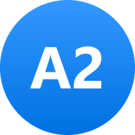
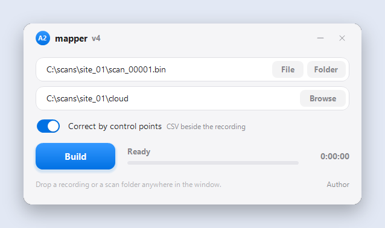
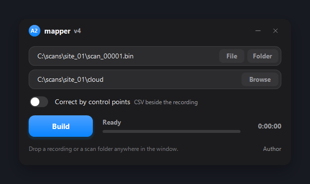

<p align="center">
  
</p>

<h1 align="center">A2 mapper</h1>

<p align="center">
  <b>Point clouds from SLAM scanner recordings. Fast, accurate, free.</b><br>
  Windows · Android
</p>

<p align="center">
  <a href="v4/A2-mapper-v4.exe"><b>⬇ Windows (.exe)</b></a> ·
  <a href="v4/A2-mapper-v4.apk"><b>⬇ Android (.apk)</b></a> ·
  <a href="https://t.me/a2blog">Telegram</a> ·
  <a href="https://www.youtube.com/@a2-lab">YouTube</a>
</p>

<p align="center">
  
  
</p>

## What it is

A2 mapper builds a dense, clean **point cloud (`.las`) and a trajectory
(`.txt`)** from raw SLAM scanner recordings:

- **ROS1 bag files** (`.bag`, uncompressed) with the topics `/livox/lidar`
  (`livox_ros_driver2/CustomMsg`) and `/livox/imu` (`sensor_msgs/Imu`) —
  recordings of **SHARE S20** SLAM scanners (Livox Mid-360);
- **`.bin` recordings** of **A2 scanners** — see the
  [OpenSLAM](https://github.com/Werdna0107/OpenSLAM) project.

The odometry algorithm was designed and written by the author independently.
It is not derived from, and does not reuse code of, well-known open-source SLAM
implementations.

Everything runs on your own device. No account, no network, no cloud: your
recordings never leave your computer or phone.

## Download

| Platform | File | Notes |
|---|---|---|
| Windows 10 / 11, x64 | [`v4/A2-mapper-v4.exe`](v4/A2-mapper-v4.exe) | one file, 1.6 MB, nothing to install |
| Android 8.0+, arm64 | [`v4/A2-mapper-v4.apk`](v4/A2-mapper-v4.apk) | runs the same engine on the phone (no control points) |

SHA-256 checksums: [`v4/SHA256SUMS.txt`](v4/SHA256SUMS.txt). The program is not
code-signed, so Windows SmartScreen may warn you on first start: choose
*More info → Run anyway*. On Android allow installation from this source.

## How to use (Windows)

1. Start **A2-mapper-v4.exe**.
2. Choose the recording:
   - **File** — a `.bag` or `.bin` recording → grey point cloud;
   - **Folder** — a whole **SHARE S20 scan folder** (the one with the `all_*.bag`
     and the `info` folder) → the cloud is also **coloured** from the scanner's
     cameras. For colour you must pick the folder, not the file.
   - or just drop a file or a folder into the window.
3. The output folder is suggested automatically. Press **Build**.
4. You get two files in the output folder: **`cloud.las`** and
   **`trajectory.txt`**.

`trajectory.txt` is plain text, one pose per line:
`x y z roll pitch yaw qx qy qz qw timestamp` (metres, radians, quaternion in
`x y z w` order, timestamp in seconds). The theme follows Windows (light or
dark).

## Getting the best quality: record a closed loop

The cloud is best when the recording is **closed**:

1. Stand still at the start for **10 seconds**.
2. Walk the whole route.
3. **Come back to exactly the same spot** you started from.
4. Stand still for **10 seconds** again, then stop the recording.

A2 mapper finds the two stationary segments and ties the finish to the start, so
the drift of the loop is closed.

## Control points (RTK) — trajectory correction

Tick **Correct by control points** and the trajectory is pulled onto your
control points. The cloud and the trajectory are then written **in the
coordinates of your points** (any metric coordinate system: local, UTM, a
national grid…). The offset between the scanner and the marked point is found
automatically.

The program looks for the points file **next to the recording**.

### SHARE S20

File name: **`ctrl_points_edit.csv`** (or `control_points.csv`), in the same
folder as the `all_*.bag`.

```csv
Name,timestamp,x,y,z
PT1,1735725777.104061985,2170499.478,312016.336,240.424
PT2,1735725849.091454401,2170487.621,311994.746,240.505
PT3,1735725916.910032466,2170468.898,312007.000,240.282
PT6,1735725968.217876747,2170476.178,311990.227,242.312
PT7,1735726039.760526743,2170490.040,312018.295,242.373
```

- `timestamp` — the moment the point was marked during the scan, in seconds, on
  the scanner's clock. SHARE saves these moments in `control_points.csv` with
  empty `x,y,z`: just fill the coordinates in and save the file as
  `ctrl_points_edit.csv`.
- `x, y, z` — coordinates of the mark in metres; they are used exactly as
  written. Rows with empty coordinates are skipped.
- At least **3** points are required; **5–7**, spread along the route, work
  best. Column names are case-insensitive, extra columns are ignored.

### A2 scanners

File name: **`scan_NNNNN.gcp.csv`**, next to `scan_NNNNN.bin`. The A2 scanner
writes it itself: the RTK position at every press of the control-point button.
Used columns: `board_real_ns`, `lat_deg`, `lon_deg`, `h_ellps_m` (optionally
`hacc_m`, `vacc_m`, `carr_soln`). Only RTK-fixed points (`carr_soln = 2`) are
used; the result is in local east-north-up metres around the first point.

## Accuracy and speed

Pure SLAM (no RTK used in the processing), measured against RTK on three real
scans. Deviation from the reference, RMS in cm, plan / height:

| Scan | Reference | SHARE PCS | A2 mapper |
|---|---|---|---|
| Street loop, 282 m (SHARE S20) | RTK along the whole route | 3.2 / 2.8 | **2.4 / 2.6** |
| Courtyard, 192 m (SHARE S20) | 5 control points | 6.9 / 3.6 | 7.1 / **1.8** |
| Street block, 777 m (A2) | 7 control points | 25.9 / 29.7 | **18.4** / 29.8 |

Time to the point cloud (no colour), same computer: **6 / 3.7 / 7 min** with A2
mapper against 11 / 7.3 / 55 min.

Your results will depend on the scanner, the route and the surroundings.

## Not affiliated

A2 mapper is an independent project. SHARE, SHARE Studio, SHARE PCS and Livox
are trademarks of their owners; they are named here only to say which recordings
the program reads.

## License

Free to use, for personal and commercial work. **Reverse engineering,
decompiling, disassembling and modification are not allowed.** Full text:
[LICENSE](LICENSE).

## Links

- Telegram — https://t.me/a2blog
- YouTube — https://www.youtube.com/@a2-lab
- OpenSLAM — https://github.com/Werdna0107/OpenSLAM
- Website — https://a2-lab.ru

<sub>#SLAM #LiDAR #PointCloud #Livox #Mid360 #SHAREslam #ROS #rosbag #LAS #Odometry #Mapping #3DScanning #Surveying #Geodesy #RTK #GNSS #GCP #ControlPoints #PointCloudProcessing #Windows #Android</sub>
